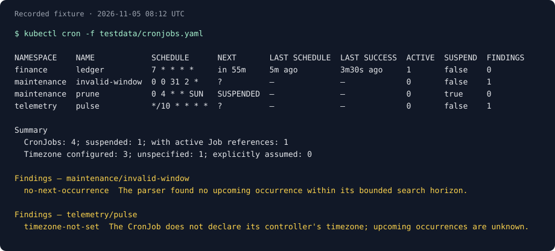

# kubectl-cron

A **read-only** kubectl plugin for CronJob schedules, upcoming occurrences, and recorded scheduling state.



The Overview reads CronJobs only. Detailed inspection also reads owned Jobs and CronJob Events. Schedule Explanations and file-based inspection work entirely offline. Findings are separate from facts and identify what deserves investigation without prescribing a fix.

## Install

Build with Go 1.27 or newer:

```sh
go build -o kubectl-cron .
```

Place `kubectl-cron` on your `PATH`, then check `kubectl plugin list`. It runs as `kubectl cron`; the binary also works directly.

Development currently uses local builds. Release publishing and Krew submission are suspended, and this repository has no publishing automation.

## Use

```sh
# CronJobs in the current namespace
kubectl cron

# Every namespace, including effective configuration
kubectl cron -A -o wide

# One CronJob; the same Overview, narrowed to one object
kubectl cron ledger -n finance

# Related Jobs and Events, explicitly requested
kubectl cron inspect ledger -n finance

# Retained executions plus explicitly unknown past slots
kubectl cron runs ledger -n finance --since=24h --limit=50

# Newest retained execution; previous Job; newest terminal failure
kubectl cron logs ledger -n finance
kubectl cron logs ledger -n finance --run-offset=1
kubectl cron logs ledger -n finance --failed -c worker

# Follow the newest active Job or read all retained Jobs
kubectl cron logs ledger -n finance -f
kubectl cron logs ledger -n finance --all --all-containers

# Findings from retained Jobs and UID-scoped Events
kubectl cron diagnose -A
kubectl cron diagnose ledger -n finance --exit-on-findings -o json

# Compact execution history; '?' means unknown, not proven skipped
kubectl cron timeline ledger -n finance --since=24h

# Upcoming nominal slots and counts of selected CronJobs sharing them
kubectl cron calendar -A --next=2h
kubectl cron calendar -f schedules.yaml --next=24h -o json

# Escape a CronJob name that matches a subcommand
kubectl cron cronjob/explain -n finance

# CronJob labels, not Job or Pod labels
kubectl cron -l team=ledger --sort=next

# Configuration Findings and an explicit CI exit status
kubectl cron --problems --exit-on-findings -o json

# Factual aggregation only
kubectl cron -A --summary=only

# Decode a schedule without a cluster; UTC is the stated default
kubectl cron explain '0 6 * * MON-FRI' --tz Europe/Berlin

# Inspect local definitions without consulting kubeconfig or the cluster
kubectl cron -f schedules.yaml
kubectl cron explain -f schedules.yaml --assume-timezone=UTC --count=5
```

`--context`, `--kubeconfig`, `-n/--namespace`, `-A/--all-namespaces`, and kubectl connection flags work on the live path. `-l` always matches CronJob labels. A name requires a single namespace.

`-f` is repeatable and accepts local YAML/JSON, multiple documents, Lists, and `-` for stdin. Definitions are analyzed as supplied: no discovery, live-object lookup, or credential loading. Other resource kinds and remote URLs are rejected. File namespaces are preserved; an explicit `-n` fills missing namespaces and rejects conflicting declarations. Omitted file namespaces remain unspecified.

`--tz` applies only to a bare expression. CronJob definitions use `spec.timeZone`; an explicit `--assume-timezone` fills only missing values and cannot override configured ones.

## Columns

| Column | Meaning |
| --- | --- |
| `NAME` | CronJob name; namespace is added when needed. |
| `SCHEDULE` | The configured expression. |
| `NEXT` | First nominal occurrence after the evaluation instant. `?` means unavailable, `*` marks a timezone assumption, and `SUSPENDED` means scheduling is suspended. |
| `LAST SCHEDULE` | Recorded `status.lastScheduleTime`; absent means not recorded. |
| `LAST SUCCESS` | Recorded `status.lastSuccessfulTime`; it can include an owned manual Job. |
| `ACTIVE` | Number of recorded active Job references, not verified running Pods. |
| `SUSPEND` | Effective suspension flag. |
| `FINDINGS` | Count of observations, including calculation uncertainty. |

Wide output adds timezone provenance, effective concurrency policy, starting deadline in seconds, successful/failed history limits, and a schedule description. It still reads no Jobs, Pods, or Events.

`--sort=name|next|last|findings` controls row order; missing times sort last. `--summary=show|only|hide` controls factual counts over the selected rows. `--problems` selects rows with Findings, rather than asserting those objects are unhealthy. `--no-findings` removes observations consistently in all formats and conflicts with `--problems` and `--exit-on-findings`.

Color supports `-c/--color=auto|always|never`; auto mode respects terminal detection, `NO_COLOR`, and `TERM=dumb`. Notes about calculation marks go to stderr. JSON and YAML contain no terminal coloring.

## Reports and exit codes

`inspect NAME` shows effective configuration, retained owned Jobs, and UID-scoped CronJob Events. It matches controller owner UIDs, so a reused name cannot attach Jobs from a deleted CronJob. Owned manual Jobs are included regardless of their names. `--limit` bounds displayed Jobs; the retained count is a sample, not complete history. This command requires live resources and rejects `-f`.

Scheduling delay measures Job creation minus its recorded nominal slot. Duration measures Job-controller time, including scheduling and Pod startup, rather than container runtime. A failed retry Pod does not make its Job failed. Missing permissions and unavailable reads remain explicit; Events are temporary evidence and can expire.

`runs NAME` combines retained owned Jobs with a bounded projection of the current schedule over `--since` (default 24h, maximum 8760h). `--limit` shows the newest entries (default 20, maximum 1000). A missing Job is `unknown`: the API cannot distinguish deleted, missed, or historically unscheduled slots. Previous schedule and suspension settings are unavailable. Relative schedules show observed Jobs without projecting an unrecorded past phase. Recorded slots determine ordering when present; manual Jobs and Jobs without a slot use creation time. No Events or Pods are read.

`logs NAME` selects the newest retained owned Job by creation time, including manual Jobs. `--run=JOB` selects an exact owned Job; `--failed` filters terminal failures; `--all` reads all retained Jobs. All retained owned Pods of selected Jobs are considered, including retries. Container choice follows the default-container annotation, then the first regular container; `-c` and `--all-containers` select others. As in [kubectl logs](https://kubernetes.io/docs/reference/kubectl/generated/kubectl_logs/), `--previous` selects the previous container instance in the same Pod. Use `--run-offset=1` for the previous Job.

Logs default to 100 lines per container; use `--tail=-1`, `--since`, or `--timestamps` as needed. Multiple streams receive identity prefixes. `--max-log-requests` bounds concurrency (default 5, maximum 20); follow rejects selections exceeding that bound. Follow attaches to currently retained Pods of the selected Job and ends when those streams end; it does not wait for future Pods or Jobs. Ctrl-C cancels all reads. A missing Pod or log is reported without inventing its deletion cause. Individual lines larger than 1 MiB fail explicitly. Logs use plain text rather than the Report formats.

`diagnose [NAME]` prints Findings from configuration, retained Job conditions and timings, and UID-scoped controller Events. It reads Jobs once per selected namespace and bounds related requests to four at a time. It makes no blanket health verdict or inferred failure streak. Unavailable reads and retention limits remain visible even when there are no Findings. `diagnose -f` stays offline and checks configuration only. Detailed inspection uses the same runtime rules; see the [rule reference](docs/rules.md).

`timeline NAME` draws the same evidence as `runs`, oldest to newest, with one symbol per displayed entry. Spacing is entry order rather than proportional elapsed time. The legend separates complete, failed, running, terminating, pending, suspended, external-controller, and unknown states. Counts cover displayed entries only. It shares the history window and truncation rules, with a default display limit of 200; JSON/YAML retain the full history model for those entries.

`calendar [NAME]` groups occurrences strictly after the evaluation time through `--next` (default 2h, maximum 8760h). It reads CronJobs only and also supports offline files. `COUNT` is the number of selected CronJobs sharing that nominal instant, across timezone boundaries; it does not predict actual simultaneous starts. Suspended objects and unavailable calculations are listed separately. `--limit` bounds distinct displayed times (default 200, maximum 1000), keeping every member of a displayed group. Wide output adds expressions, timezone provenance, and local times. The `coincident-schedules` Finding summarizes shared displayed slots without prescribing a change.

Use `-o json` or `-o yaml` for the shared `cron.kubectl.dev/v1alpha1` [Report contract](docs/report.md). Unknown timestamps are null with a reason; timezone sources and relative-schedule reference points remain explicit. Match a Finding's stable `rule` ID, rather than its message. The [rule reference](docs/rules.md) describes the initial checks.

Exit 0 means inspection completed, including when invalid configuration was reported. Exit 1 means an argument, file, API, or output error. `--exit-on-findings` enables exit 2 when Findings exist; an operational error still wins. Summary-only still evaluates Findings for this explicit exit-code check.

## Limits

- NEXT describes scheduling intent, not a guarantee of Job creation. Deadlines, concurrency policy, controller availability, and catch-up behavior affect execution.
- An omitted timezone belongs to the controller manager and is not discoverable from a CronJob. It stays unknown unless explicitly assumed. A client timezone-resolution failure does not prove a controller failure.
- Relative `@every` schedules use the last recorded schedule or creation time as their reference point; an offline expression uses the displayed evaluation time. They are nominal previews, not controller catch-up predictions. Missing reference data stays unavailable.
- The parser has a bounded search horizon. No returned date is reported as “no occurrence found,” rather than proof that a schedule can never match.
- Status fields do not reveal complete execution history. v0.1 reports no retained-run ratios, failure streaks, skipped-run totals, or suspension duration.
- The compatibility target is Kubernetes 1.35-1.37. Older `batch/v1` clusters are best effort without a version gate. Automated verification uses saved API data and scheduling cases; use the [local demo](hack/demo-cluster/README.md) for live validation.

## Development

```sh
make check
go test -race ./...
```

The fixture pipeline checks collection, analysis, human presentation, and JSON/YAML output. DST and relative-cadence tests use a fixed clock. The screenshot above is rendered from the same recorded fixture output, not a claim about a live cluster.

Read the [glossary](GLOSSARY.md), [v0.1 design](docs/v0.1-design.md), and [ADRs](docs/adr/) before changing domain behavior. The implementation follows the presentation conventions of [kubectl-probes](https://github.com/mertdotcc/kubectl-probes).

## Related tools

Use kube-state-metrics for monitoring and alerting infrastructure. Use `kubectl create job --from=cronjob/NAME` or `exec-cronjob` to trigger work. This plugin provides terminal inspection without additional cluster components.

## License

Apache 2.0. See [LICENSE](LICENSE).
